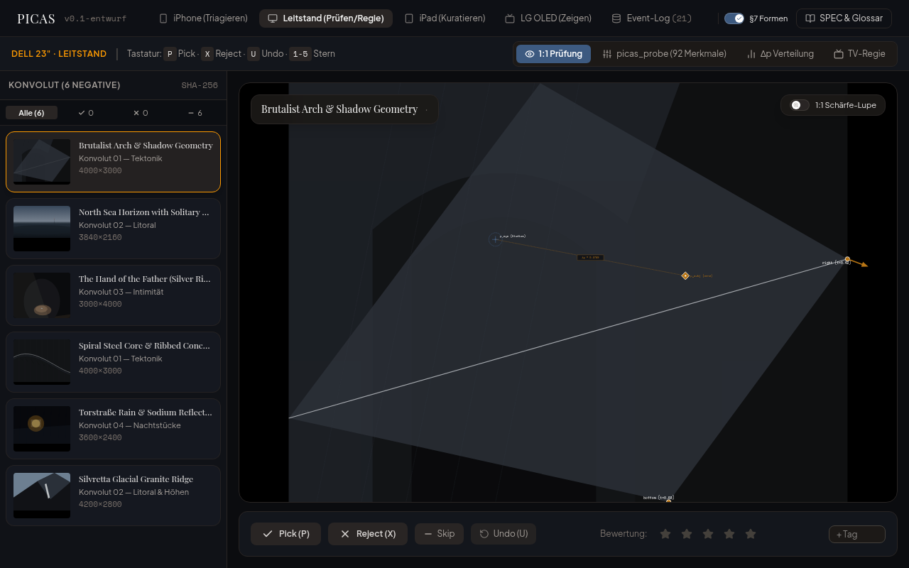
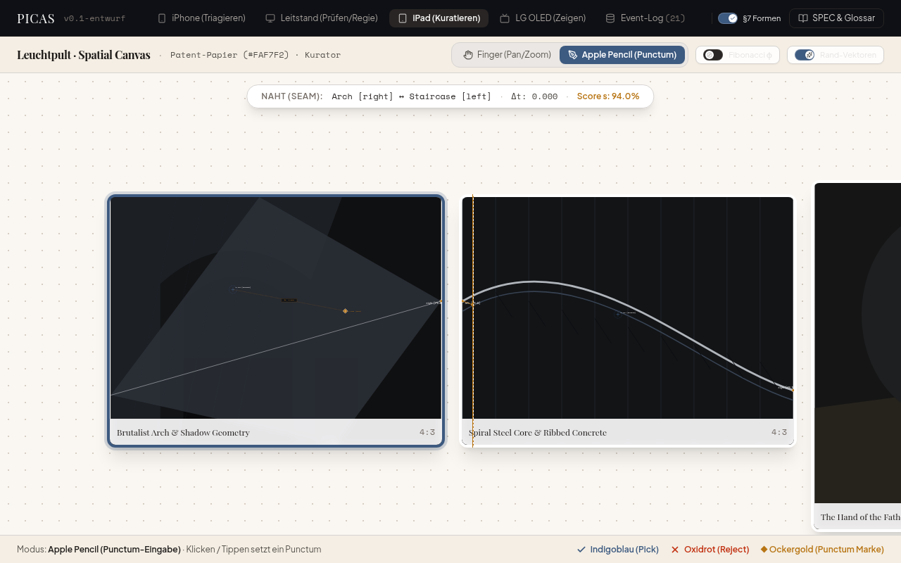
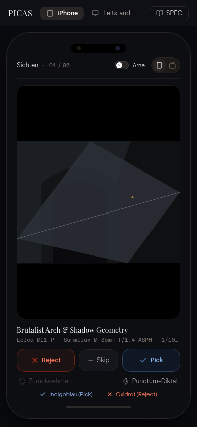

# PICAS — Photographic Curation & Analysis System

Entwurf einer Foto-Kuration, die auf vier Geräte verteilt ist: Auf dem iPhone sichten, am Leitstand prüfen, auf dem iPad kuratieren, am OLED-Fernseher zeigen. Alle Eingaben landen in einem Ereignisprotokoll, das nur angehängt und nie verändert wird.

Dieses Repository ist die **lauffähige Browser-Simulation** der Idee (React 19, Vite, Tailwind). Sie arbeitet mit sechs mitgelieferten Beispielbildern und speichert alles im Browser. Es gibt kein Backend.

**Stand:** Entwurf `v0.1-entwurf` (Oktober 2026). Ein Prototyp zum Ausprobieren, kein fertiges Produkt.



| iPad (Kuratieren) | iPhone (Sichten) |
|---|---|
|  |  |

## Was die Oberfläche zeigt

Die fünf Ansichten stehen oben in der Leiste. Alles Folgende steht so im Code.

| Ansicht | Rolle | Was dort geht |
|---|---|---|
| **iPhone (Triagieren)** | Sichten | Bilder einzeln durchgehen und mit Pick, Reject oder Skip markieren, Rückgängig, Punctum-Notiz als Text (das „Diktat" füllt nur einen Beispieltext ein, es erkennt keine Sprache), zweiter Reiter als Fernbedienung für die Galerie |
| **Leitstand (Prüfen/Regie)** | Prüfen | Bildliste („Konvolut"), Tastaturkürzel `P` Pick, `X` Reject, `U` Undo, `1`–`5` Sterne, Tags; Reiter „1:1 Prüfung", „picas_probe (92 Merkmale)", „Δp Verteilung", „TV-Regie" |
| **iPad (Kuratieren)** | Kuratieren | „Leuchtpult": Bilder nebeneinander verschieben, die „Naht" zwischen zwei Bildrändern bewerten lassen (Seam-Score), Punctum-Punkte mit dem Modus „Apple Pencil" setzen, im Modus „Finger" schieben und zoomen |
| **LG OLED (Zeigen)** | Zeigen | Galerie im Vollbild, statisch oder als „Fahrt"; die Steuerung ist per Leihe (Lease) jeweils einem Gerät zugeteilt |
| **Event-Log** | Prüfen | Alle Ereignisse mit Zähler, Rückgängig, Export als NDJSON, Zurücksetzen |

Dazu kommen ein Fenster „SPEC & Glossar" (Invarianten und Formeln des Entwurfs) und ein Schalter „§7 Formen", der Pick und Reject zusätzlich als Haken und Kreuz zeigt, damit sie nicht nur an der Farbe erkennbar sind.

## Wie es funktioniert

- **Ereignisprotokoll.** Jede Aktion wird als Ereignis angehängt. Es gibt kein Ändern und kein Löschen. „Rückgängig" fügt ein weiteres Ereignis hinzu (`meta.undo`).
- **Herkunft pro Ereignis.** Menschliche Ereignisse tragen Gerät, Eingabeart, Zoomstufe und Zeitstempel. Systemereignisse tragen vier Hashes (`schema_hash`, `analyzer_version`, `param_hash`, `code_hash`).
- **Projektionen.** Der Stand (Sichtung, Punctum-Marken, Δp) wird jederzeit aus dem Protokoll neu berechnet. Die Formeln stehen in `src/utils/math.ts`, geprüft von `src/utils/math.test.ts`.
- **Beispielbilder.** Die sechs Bilder in `src/data/seedImages.ts` sind keine Fotos. Sie haben Titel, Aufnahmedaten, Messwerte und Rand-Vektoren und werden auf einer Zeichenfläche (`src/components/PhotographicCanvas.tsx`) als einfache Formen gezeichnet.
- **Speicherort.** Das Protokoll liegt im `localStorage` des Browsers (Schlüssel `picas_append_only_event_log_v1`). Daten verlassen den Browser nicht.

## Starten

Voraussetzung: Node.js `20.19` oder neuer (oder `22.12+`), so verlangt es Vite 8.

```bash
git clone https://github.com/aom1941/PICAS-Collection.git
cd PICAS-Collection
npm install
npm run dev
```

Dann `http://localhost:3000` öffnen. Der Dev-Server lauscht auf allen Netzwerkadressen (`--host=0.0.0.0`); in einem fremden Netz besser `npx vite --port=3000 --host=127.0.0.1` verwenden.

Weitere Befehle:

| Befehl | Wirkung |
|---|---|
| `npm test` | 12 Tests für Projektionen, Herkunftsprüfung und Statussymbole |
| `npm run lint` | Typprüfung mit `tsc --noEmit` |
| `npm run build` | Produktions-Build nach `dist/` |

Stand der Prüfung (mit `package-lock.json` aus diesem Repository): `npm install` ohne Zusatzflag, `npm test` 12 von 12 bestanden, Typprüfung ohne Fehler, Build erfolgreich.

## Bekannte Grenzen

- Kein Backend, keine Anmeldung, keine Synchronisation zwischen echten Geräten. Die vier „Geräte" sind Ansichten im selben Browser.
- Die Schriften kommen von Google Fonts (`index.html`). Offline oder ohne Verbindung fällt die Oberfläche auf Systemschriften zurück.
- Es gibt keine Tests für die Oberflächen, nur für die Rechenlogik.

## Ordner

```
src/
  App.tsx                 Leiste, Ansichtswechsel, Glossar
  components/devices/     iPhone, Leitstand, iPad, OLED, Event-Log
  components/             Zeichenfläche, Statusabzeichen
  store/eventStore.ts     Ereignisprotokoll, Projektionen, Lease
  utils/math.ts           Δp, Rand-Kontinuität, Herkunftsprüfung
  data/seedImages.ts      sechs Beispielbilder
  types/picas.ts          Typen für Ereignisse und Bilder
```

## Lizenz

Noch nicht festgelegt. Es liegt keine `LICENSE`-Datei im Repository; nur `src/App.tsx` trägt im Kopf den Vermerk `SPDX-License-Identifier: Apache-2.0` (aus der AI-Studio-Vorlage). Bis eine Lizenz gewählt ist, gilt: alle Rechte vorbehalten.
